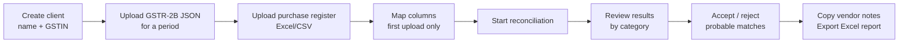
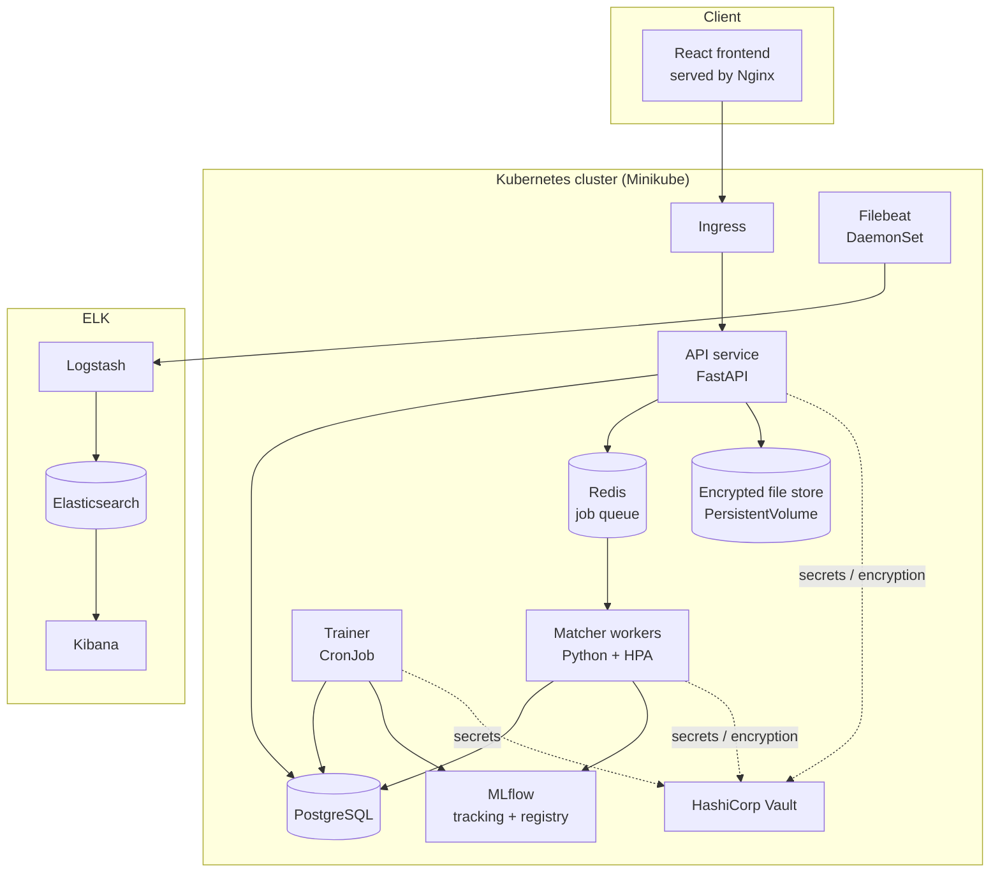
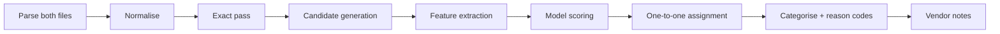
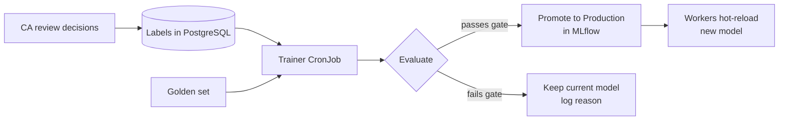
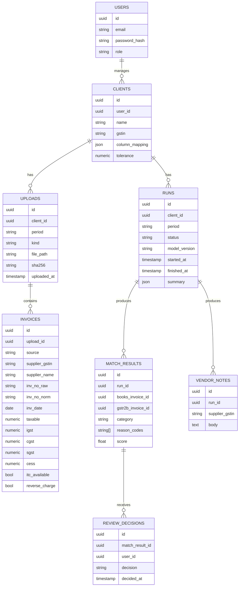

# GSTR-2B Reconciler: System Design Document

**Course:** CSE 816 Software Production Engineering, Final Project
**Domain:** Finance + MLOps
**Status:** v1.1, 13 November 2026. Section 22 lists what changed during the build.

---

## 1. Overview

Every month, each GST-registered business must match its purchase records against GSTR-2B, the government's auto-generated statement of claimable input tax credit (ITC), before filing GSTR-3B. Most small CA firms still do this by hand in Excel, client by client, invoice by invoice.

We are building a web application that automates this matching. A CA uploads a client's GSTR-2B file and purchase register. The system matches invoices, explains every mismatch, and drafts follow-up notes for vendors. A machine learning model handles the messy cases (typos, rounding, date shifts) and improves from the CA's own review decisions.

The whole system is delivered through a DevOps pipeline that tests the correctness of the financial results and the quality of the model on every commit, before anything reaches deployment.

---

## 2. Goals and Non-Goals

### 2.1 Goals

1. Reconcile one client's GSTR-2B against their purchase register for one tax period.
2. Classify every invoice into a clear category with machine-readable reason codes.
3. Use an ML model to find probable matches that exact matching misses.
4. Learn from CA review decisions through an automated retraining pipeline.
5. Block any deployment that lowers reconciliation accuracy.
6. Meet every mandatory and advanced requirement in the course rubric.

### 2.2 Non-Goals (v1)

- Filing returns or connecting to the GST portal directly. Users download files from the portal and upload them.
- Credit/debit notes (CDNR), amendments (B2BA), import of goods (IMPG) and ISD sections. B2B invoices only.
- Multi-period reconciliation (carrying unmatched invoices across months).
- Mobile app.

---

## 3. Users and Core Workflow

**Primary user:** a CA or their staff handling GST compliance for several clients.



---

## 4. Functional Requirements

| ID | Requirement |
|----|-------------|
| FR1 | User login with email and password |
| FR2 | Create and list clients, each with a validated GSTIN |
| FR3 | Upload GSTR-2B JSON and purchase register (xlsx/csv) per client per period |
| FR4 | Column mapping for the purchase register, saved per client |
| FR5 | Run reconciliation as a background job and show progress |
| FR6 | Show results grouped by category, with reason codes and amounts |
| FR7 | Accept, reject or manually link probable matches |
| FR8 | Generate a draft follow-up note per vendor with discrepancies |
| FR9 | Export full results to Excel |
| FR10 | Show the model version used for each run |

## 5. Non-Functional Requirements

| ID | Requirement | Target |
|----|-------------|--------|
| NFR1 | Reconciliation time for 2,000 invoices | under 30 seconds |
| NFR2 | Zero-downtime deployments | no failed requests during rollout |
| NFR3 | Horizontal scaling under load | workers scale 1 to 5 via HPA |
| NFR4 | Secrets never stored in Git or images | all secrets from Vault |
| NFR5 | Uploaded files encrypted at rest | Vault Transit encryption |
| NFR6 | Every request and run traceable in logs | request_id and run_id on every log line |
| NFR7 | Model quality gate on every commit | precision and recall thresholds in CI |

---

## 6. System Architecture



### 6.1 Components

| Component | Tech | Responsibility |
|-----------|------|----------------|
| Frontend | React, Vite, Nginx | Upload, column mapping, results review, exports |
| API service | Python, FastAPI | Auth, clients, uploads, run orchestration, results, exports |
| Job queue | Redis + RQ | Holds reconciliation jobs between API and workers |
| Matcher worker | Python, rapidfuzz, XGBoost | Parsing, normalisation, exact and ML matching, notes |
| Trainer | Python, scikit-learn, XGBoost | Retrains the model from review decisions, evaluates, promotes |
| Model registry | MLflow (PostgreSQL backend) | Model versions, metrics, "Production" stage |
| Database | PostgreSQL | Clients, invoices, runs, results, decisions |
| File store | PersistentVolume | Uploaded files, encrypted via Vault |
| Secrets | HashiCorp Vault | DB credentials, Docker Hub token, Transit encryption keys |
| Logging | Filebeat, Logstash, Elasticsearch, Kibana | Collect, index and visualise all logs |

### 6.2 Why this split

The API stays fast and thin because heavy matching runs in separate workers. Workers are the part that needs to scale, so they get the HPA. The trainer runs on its own schedule and never touches live traffic. Every service is its own Docker image, so each one can be rebuilt and rolled out independently.

---

## 7. Data Inputs

### 7.1 GSTR-2B (JSON from the GST portal)

We parse the B2B section. Per supplier: supplier GSTIN, trade name, and a list of invoices. Per invoice: invoice number, date, invoice value, place of supply, reverse charge flag, ITC availability flag, and line items with taxable value, rate, IGST, CGST, SGST and cess.

> **Done:** field names are confirmed in `docs/gstr2b-schema.md`, with sources. Since October 2024 the portal puts amounts directly on each invoice instead of in an `items` list, and `version` stays `"1.0"` in both formats. The parser reads both formats and tells them apart by whether `items` is present.

### 7.2 Purchase register (xlsx/csv from Tally or Excel)

Required logical columns: supplier GSTIN, supplier name, invoice number, invoice date, taxable value, IGST, CGST, SGST, cess. Column names vary by client, so the user maps them once and the mapping is saved per client.

### 7.3 Synthetic data generator

Real client data is confidential, so we build `datagen/`, a generator that produces realistic paired datasets with known ground truth:

1. Create suppliers with valid GSTINs (correct format and checksum character).
2. Create a clean set of invoices for the period: the "books".
3. Copy them into a GSTR-2B version and plant controlled errors:

| Planted error | Example |
|---------------|---------|
| Supplier did not file | invoice dropped from 2B |
| Invoice number format | `INV/0042` vs `INV-42` vs `2025-26/42` |
| Date shift | 1 to 5 days apart |
| Rounding | ±₹1 difference |
| Value error | taxable value off by a real amount |
| GSTIN typo | one character wrong, same PAN |
| Tax head swap | IGST in one, CGST+SGST in the other |
| Extra invoice | in 2B but missing from books |
| ITC not available | ineligible flag set in 2B |

Every pair carries a ground-truth label. A fixed-seed run of the generator produces the **golden set** used by CI.

---

## 8. Reconciliation Engine

### 8.1 Pipeline



### 8.2 Normalisation

- **GSTIN:** uppercase, trim, validate format and checksum. Extract the PAN (characters 3 to 12).
- **Invoice number:** uppercase, strip spaces and punctuation, drop financial-year prefixes like `2025-26/`, strip leading zeros from the numeric part. Keep the raw value for display.
- **Dates:** parse multiple formats into ISO dates.
- **Amounts:** round to 2 decimals and compute total tax.

### 8.3 Exact pass

Match on (supplier GSTIN, normalised invoice number). If all amounts fall within the tolerance (default ₹1, configurable per client), the pair is **Matched**. If the key matches but amounts differ beyond tolerance, it is a **Mismatch** with value reason codes.

### 8.4 Candidate generation (unmatched leftovers only)

- Same supplier GSTIN, any invoice number.
- Same PAN with a different GSTIN (catches GSTIN typos and wrong state registrations).
- Total value within 5% and date within 10 days (catches badly mangled invoice numbers).

This keeps the pair count small, so scoring stays fast.

### 8.5 Features per candidate pair

| Group | Features |
|-------|----------|
| Invoice number | Levenshtein ratio, Jaro-Winkler, numeric-part equality, token overlap, length difference |
| Identity | GSTIN exact match, same PAN, GSTIN edit distance |
| Date | absolute day difference, same month |
| Amounts | absolute and relative difference in taxable value, total tax and invoice total |
| Tax structure | IGST vs CGST+SGST mismatch flag |

### 8.6 Model

- **Type:** gradient boosted classifier (XGBoost). It outputs the probability that a pair is the same invoice.
- **Assignment:** within each supplier group, pairs are assigned one-to-one in order of highest probability, so no invoice gets matched twice.
- **Thresholds:** probability ≥ 0.90 becomes **Probable match**. Between 0.50 and 0.90 it becomes **Needs review**. Below 0.50 the invoices stay unmatched. Both thresholds are config values.
- **Cold start:** version 1 trains on synthetic data only. Later versions add real review decisions.

### 8.7 Result categories

| Category | Meaning |
|----------|---------|
| Matched | Same invoice, amounts within tolerance |
| Probable match | Model is confident it is the same invoice despite differences |
| Needs review | Model is unsure, CA decides |
| Mismatch | Same invoice, amounts differ beyond tolerance |
| Missing in 2B | In books but not in 2B (supplier likely has not filed) |
| Missing in books | In 2B but not recorded in books |
| ITC not available | In 2B but flagged ineligible |

### 8.8 Reason codes

`VALUE_DIFF`, `TAX_DIFF`, `TAX_HEAD_DIFF`, `DATE_DIFF`, `INV_NO_FORMAT`, `GSTIN_TYPO`, `MISSING_IN_2B`, `MISSING_IN_BOOKS`, `ITC_INELIGIBLE`

### 8.9 Vendor notes

Template-based and deterministic. For each supplier with `MISSING_IN_2B` or value mismatches, the system lists the affected invoices with amounts and asks the supplier to file or correct their GSTR-1. Notes are plain text the CA can copy into email or WhatsApp.

---

## 9. MLOps Lifecycle



### 9.1 Training data

- Synthetic pairs from the generator (always included, so the model never forgets basic cases).
- Every accept, reject and manual link from the review screen becomes a labelled pair.

### 9.2 Retraining trigger

The trainer runs as a Kubernetes CronJob every night. It also runs on demand from a Jenkins job. It skips training if fewer than 50 new labels exist since the last version.

### 9.3 Evaluation gate

A candidate model is promoted only if, on the golden set **and** a held-out slice of real labels:

- pair-match precision ≥ 0.98
- pair-match recall ≥ 0.95
- F1 is no lower than the current Production model

These thresholds live in `config/quality_gate.yaml` and start as targets to tune once we have real numbers.

### 9.4 Model registry and serving

MLflow stores every model version with its metrics, training data hash and git SHA. Workers poll the registry every 60 seconds. When a new Production version appears, they load it in the background and swap it atomically, so model updates need no pod restart. Every run records the model version it used.

---

## 10. Data Model (PostgreSQL)



Schema changes go through Alembic migrations, which run as a Kubernetes Job before each API rollout.

---

## 11. API Design

All endpoints sit under `/api/v1`, use JSON and require a JWT (except login and health).

| Method | Path | Purpose |
|--------|------|---------|
| POST | `/auth/login` | Get a JWT |
| GET / POST | `/clients` | List or create clients |
| PUT | `/clients/{id}/mapping` | Save purchase register column mapping |
| POST | `/clients/{id}/uploads` | Upload a file (`kind`, `period`) |
| POST | `/clients/{id}/runs` | Start reconciliation for a period |
| GET | `/runs/{id}` | Status, summary counts, model version |
| GET | `/runs/{id}/results?category=` | Paged results |
| POST | `/results/{id}/decision` | Accept, reject or manual link |
| GET | `/runs/{id}/vendor-notes` | Draft notes per supplier |
| GET | `/runs/{id}/export` | Excel export |
| GET | `/healthz`, `/readyz` | Liveness and readiness probes |

---

## 12. Security

| Area | Approach |
|------|----------|
| Authentication | JWT with short expiry, bcrypt password hashes |
| Secrets | Vault KV for DB credentials and Docker Hub token. Pods authenticate with Vault's Kubernetes auth method and receive secrets through the Vault Agent Injector |
| File encryption | Uploaded files encrypted with Vault's Transit engine before they touch disk. The key never leaves Vault |
| CI credentials | Jenkins reads Docker Hub and kubeconfig credentials from Vault through the Jenkins Vault plugin |
| Image scanning | Trivy scans each image in the pipeline. Critical vulnerabilities fail the build |
| Logs | Logs carry IDs and counts only, never invoice amounts or supplier names |
| Retention | Uploaded files deleted after a configurable number of days (default 90) |

---

## 13. DevOps Pipeline

### 13.1 Flow

```mermaid
flowchart LR
    D[Developer push] --> GH[GitHub]
    GH -- webhook: GitHub hook trigger<br/>for GITScm polling --> J[Jenkins]
    J --> S1[Lint + unit tests]
    S1 --> S2[Golden-set<br/>reconciliation tests]
    S2 --> S3[Model quality gate]
    S3 --> S4[Build images<br/>tagged with git SHA]
    S4 --> S5[Trivy scan]
    S5 --> S6[Push to Docker Hub]
    S6 --> S7[Ansible deploy<br/>rolling update on K8s]
    S7 --> S8[Smoke test]
    S8 -- fails --> RB[Automatic rollback]
```



### 13.2 Jenkins stages

| Stage | What it does | Fails the build when |
|-------|--------------|----------------------|
| Checkout | Pulls the commit that triggered the hook | |
| Lint + unit tests | ruff, pytest, frontend tests | any test fails |
| Golden-set tests | Runs the full matcher on the golden set, compares every category against ground truth | any category count differs from expected |
| Model quality gate | Evaluates the current Production model and any candidate against thresholds | precision or recall below threshold |
| Build | Builds `frontend`, `api`, `matcher`, `trainer` images tagged `:<git-sha>` and `:latest` | build error |
| Scan | Trivy on each image; it also writes a CycloneDX SBOM per image, archived with the build, so every deployed image comes with a list of exactly what is inside it | critical CVE found |
| Push | Pushes images to Docker Hub using credentials from Vault | push error |
| Deploy | Runs the Ansible `app_deploy` role, which updates image tags and applies manifests | rollout not healthy within timeout |
| Smoke test | Calls `/healthz` and runs a 20-invoice reconciliation end to end | wrong result or error |
| Post | On failure after deploy, runs `kubectl rollout undo` | |

### 13.3 Containerisation

Each service has its own multi-stage Dockerfile with a non-root user. `docker-compose.yml` runs the full stack locally (app, PostgreSQL, Redis, MLflow, Vault in dev mode, ELK) for development and quick checks.

### 13.4 Ansible roles

```
deploy/ansible/
├── site.yml
├── inventory/hosts.ini
└── roles/
    ├── common/        # base packages, users
    ├── docker/        # Docker engine
    ├── k8s_cluster/   # Minikube, metrics-server, ingress addon
    ├── vault/         # Vault install, unseal, policies, K8s auth
    ├── elk/           # Elasticsearch, Logstash, Kibana, Filebeat
    └── app_deploy/    # namespaces, manifests, image tags, migrations
```

`site.yml` provisions a fresh machine end to end. Jenkins calls only `app_deploy` on each commit.

### 13.5 Kubernetes

| Object | Purpose |
|--------|---------|
| Deployments | frontend, api, matcher-worker, mlflow |
| StatefulSets | postgresql, redis |
| CronJob | trainer |
| Job | database migrations before each rollout |
| HPA | matcher-worker: CPU target 60%, min 1, max 5. api: CPU target 70%, min 2, max 4 |
| Probes | readiness and liveness on every Deployment |
| Rolling update | `maxUnavailable: 0`, `maxSurge: 1` |
| Ingress | routes `/` to frontend and `/api` to api |
| PersistentVolumeClaims | database, file store, MLflow artifacts |

### 13.6 Zero-downtime updates and live patching

- **Code:** rolling updates with readiness probes. Old pods keep serving until new ones are ready.
- **Model:** workers hot-swap the model from the registry without a restart (Section 9.4).
- **Proof:** during the demo, a k6 script sends steady traffic through a rollout and reports zero failed requests.

---

## 14. Logging and Monitoring (ELK)

### 14.1 Log pipeline

All services write structured JSON logs to stdout. Filebeat runs as a DaemonSet, collects container logs and ships them to Logstash. Logstash parses the JSON, adds Kubernetes metadata and writes to Elasticsearch. Kibana visualises the results.

### 14.2 Log schema

```json
{
  "ts": "2026-11-10T10:15:02Z",
  "level": "INFO",
  "service": "matcher",
  "request_id": "a1b2...",
  "run_id": "c3d4...",
  "event": "run_completed",
  "duration_ms": 8421,
  "model_version": "7",
  "counts": {"matched": 1820, "probable": 64, "review": 21, "mismatch": 15, "missing_in_2b": 48, "missing_in_books": 12}
}
```

### 14.3 Kibana dashboards

| Dashboard | Panels |
|-----------|--------|
| Operations | Request rate, error rate, p95 latency per endpoint, pod restarts, logs per pod |
| Reconciliation | Runs per day, run duration, category distribution, top reason codes |
| Model | Model version timeline, auto-match rate, review accept rate per version, quality gate pass/fail history |
| Pipeline | Deploy events, rollbacks, smoke test results |

---

## 15. Testing Strategy

| Level | Tooling | Covers |
|-------|---------|--------|
| Unit | pytest | GSTIN checksum, normalisers, parsers, feature extraction, note templates |
| Golden set | pytest + datagen | Full engine against planted errors with known answers |
| Model gate | trainer evaluation script | Precision, recall and F1 thresholds |
| API | pytest + httpx | Auth, uploads, run lifecycle, decisions |
| Frontend | Vitest | Upload flow, results table, review actions |
| Smoke | Jenkins stage | Live deployment returns correct results |
| Load | k6 | Filing-week spike to trigger HPA and zero-downtime rollout check |

---

## 16. Repository Structure

```
gstr2b-reconciler/
├── frontend/              # React app + Nginx config + Dockerfile
├── api/                   # FastAPI service + Alembic migrations + Dockerfile
├── matcher/               # parsing, normalisation, matching engine, worker + Dockerfile
├── trainer/               # retraining and evaluation + Dockerfile
├── datagen/               # synthetic dataset generator
├── config/
│   ├── quality_gate.yaml
│   └── matching.yaml      # tolerances and thresholds
├── tests/
│   ├── unit/
│   ├── golden/            # fixed-seed golden dataset + expected outputs
│   └── load/              # k6 scripts
├── deploy/
│   ├── docker-compose.yml
│   ├── k8s/               # manifests
│   ├── ansible/           # roles (Section 13.4)
│   └── elk/               # Logstash pipeline, Filebeat config, Kibana exports
├── Jenkinsfile
└── DESIGN.md
```

---

## 17. Demo Script (maps to evaluation)

1. Show the running app and complete a reconciliation on a synthetic client.
2. Make a small visible UI change, push to GitHub, and show Jenkins start automatically.
3. Walk through the stages: tests, golden set, quality gate, build, scan, push to Docker Hub, Ansible deploy.
4. Refresh the app and show the change live, with k6 confirming zero failed requests during the rollout.
5. Push a deliberately bad commit that breaks invoice number normalisation. Show the golden-set stage failing and nothing deploying.
6. Run the k6 filing-week load test and show the matcher HPA scaling from 1 to 5 pods.
7. Accept and reject probable matches, trigger retraining, show the new model promoted in MLflow and picked up by workers without a restart.
8. Open Kibana: operations, reconciliation, model and pipeline dashboards.
9. Show Vault holding every secret and an uploaded file sitting encrypted on disk.

---

## 18. Rubric Mapping

| Rubric item | Where it is covered |
|-------------|---------------------|
| Git + GitHub | Section 13.1 |
| Jenkins + GitHub hook trigger for GITScm polling | Sections 13.1, 13.2 |
| Automated tests | Sections 13.2, 15 |
| Docker + Docker Compose | Section 13.3 |
| Push images to Docker Hub | Section 13.2 |
| Ansible playbooks | Section 13.4 |
| Kubernetes deployment | Section 13.5 |
| Changes visible on refresh | Section 17, step 4 |
| ELK logs + Kibana dashboards | Section 14 |
| Vault | Section 12 |
| Ansible roles | Section 13.4 |
| Kubernetes HPA | Section 13.5, demo step 6 |
| Live patching | Section 13.6 |
| Innovation | Model quality gate in CI, model hot-swap, feedback-driven retraining |
| Domain-specific | Finance (GST compliance) + MLOps (Section 9) |

---

## 19. Build Plan (4 weeks)

| Week | Deliverables |
|------|--------------|
| 1 | Data generator, golden set, parsers, normaliser, exact matcher, API skeleton, Docker Compose stack |
| 2 | Candidate generation, features, XGBoost v1, review UI, Jenkins pipeline through Docker Hub push |
| 3 | Kubernetes manifests, Ansible roles, Vault integration, ELK with Filebeat, automated deploy + rollback |
| 4 | Trainer CronJob, MLflow registry, hot-swap, HPA load test, Kibana dashboards, demo rehearsal |

**Rule:** the core pipeline (push to deploy to visible change to logs in Kibana) must work end to end by the end of week 3, before any time goes into retraining.

---

## 20. Risks and Mitigations

| Risk | Impact | Mitigation |
|------|--------|------------|
| Retraining loop not ready in time | Project marked partial | Core pipeline first; retraining is the last feature built |
| GSTR-2B JSON schema differs from our assumptions | Parser breaks | Verify against a real download in week 1; parser behind an interface |
| Minikube runs out of memory with ELK + app | Demo instability | Single-node Elasticsearch with reduced heap; test full stack on demo laptop early |
| Vault sealed after restart | Pods cannot start | Ansible `vault` role includes unseal step; document recovery |
| Model overfits synthetic data | Poor real-world matches | Keep thresholds conservative; low-confidence pairs go to review |
| Flaky demo network | Webhook does not fire | Expose Jenkins with a stable tunnel; keep a manual trigger as backup |

---

## 21. Open Questions

1. Final submission date, so the build plan can be adjusted.
2. Team roles: who owns ML, backend, frontend and infrastructure.
3. Demo hardware: one laptop running everything or a separate VM for Kubernetes.

---

## 22. Changes During the Build

What the code does differently from the sections above, and why.

| Section | Design said | Built | Why |
|---------|-------------|-------|-----|
| 7.3 | One planted error per invoice | Also combined errors (3 kinds) and "lookalike" pairs: two different invoices from one supplier with the same amount and close dates | With one error per invoice the model scored 1.0, which proved nothing. On the harder data the v1 model fails the gate (precision 0.81) and v2 passes |
| 8.6 | Probable match is any pair the model scores ≥ 0.90 | Same, and the pair stays probable or needs-review even when amounts differ; the amount reason codes are still attached | The CA has to confirm it is the same invoice before an amount difference means anything |
| 8.9, 10 | Vendor notes stored in a `VENDOR_NOTES` table | Built from the results each time they are requested | The same input always gives the same text, and notes cannot go stale after review decisions |
| 9.3 | Gate on the golden set and a real-label holdout | Golden-set metrics count only the pairs the model is responsible for (the ones exact matching misses) | Overall metrics would hide a bad model behind the easy exact matches |
| 9.4 | Workers poll the registry and swap models | Workers run rq `SimpleWorker` (no fork per job), and a background thread polls MLflow | With rq's default forking worker, jobs deadlocked after XGBoost and the poll thread had started |
| 9.4 | MLflow "Production" stage, PostgreSQL backend | MLflow 3 `production` alias; SQLite on a volume; artifacts served by the MLflow server | MLflow 3 replaced stages with aliases. One MLflow pod needs no separate database, and the stock image has no PostgreSQL driver |
| 9.4 | (not covered) | `python -m trainer --bootstrap` registers the model baked into the image as `r1` | Workers need a model the first time the stack starts |
| 12 | Files encrypted with Vault Transit | Done; the upload fails with 503 when Vault is down | Never fall back to writing plaintext |
| 13.3 | One image per service | `api`, `worker` and `trainer` are targets of one Dockerfile; `frontend` has its own | They share all their Python code and dependencies, and each target is still built and deployed on its own |
| 14 | ELK only in Kubernetes | Also an optional compose overlay (`deploy/docker-compose.elk.yml`); dashboards are generated by `deploy/elk/build_dashboards.py` | The dashboards could then be built and checked against real logs before the cluster existed |
| 15 | (not covered) | Runs stuck in `running` for 15 minutes are marked failed (`WorkerLost`); queued runs get 2 hours | Seen when a worker restarted in the middle of a job |
| 8.4 | Candidates: every leftover pair for the same supplier or PAN | Same-supplier pairs only within 45 days or 5% of the amount, and at most 25 candidates per books invoice | One supplier with 2,000 unmatched invoices on each side made 4 million pairs (about 134 s); now 50,000 pairs and 4.7 s |
| 11, 12 | Uploads parsed in the API | Parsed in a separate process (`api/parsing.py`) with limits on size, unzipped size and row count | pandas parsing holds Python's GIL, so a large xlsx stalled every other request, including health checks |
| 8.9 | Notes from the engine's result | Notes apply the CA's latest decision: a rejected pair counts as missing in 2B, a manual link takes both invoices off the missing lists | A letter must not chase an invoice the CA has already resolved |
| 13.5 | Rolling update with readiness probes is enough for zero downtime | Also a `preStop` sleep on api and frontend, and 2 frontend replicas | Under k6 load a rollout still failed 18 of ~1,900 UI requests: pods stopped before the ingress removed them. With the sleep: 0 of 4,131 |
| 13.5 | Worker probes ask Redis whether the rq worker is alive | Probes check the age of a heartbeat file the worker writes | Starting Python for every probe cost ~100m CPU per idle pod, which alone kept the HPA at 5 replicas |
| 12, 13.5 | Vault Agent Injector annotations in the base manifests | A separate kustomize overlay, `deploy/k8s-vault`, chosen with `app_use_vault` | The base must work before Vault is installed; pointing the app at a missing Vault made every upload fail |
| 12 | Vault unsealed by the Ansible role | Dev mode for the demo; the role re-creates engines, policies and KV secrets (from the Kubernetes Secret) on every run | Dev-mode Vault forgets everything on restart; recovery is now one playbook run |
| 13.4 | Deploy reports changes from `kubectl apply` output | `kubectl diff` decides | The postgres StatefulSet always printed "configured", so every run looked like a change |
| 13.2 | Jenkins set up by hand | `deploy/jenkins`: image plus Configuration as Code (credentials, env vars, job with the GitHub hook trigger) | One command gives a working Jenkins; nothing to click |
| 14 | Logs and Kibana dashboards only (ELK) | Also Prometheus + Grafana (`deploy/k8s-monitoring`): app metrics from `/metrics` on api and worker, pod CPU and memory from the kubelet's cAdvisor, one provisioned read-only dashboard | The 2026-27 statement asks for metrics dashboards; cAdvisor instead of kube-state-metrics and node-exporter keeps it at ~200 MiB on a 6 GB minikube |
| 12 | Jenkins reads Docker Hub and kubeconfig credentials from Vault | The Docker Hub token only (stored with its user at `secret/jenkins/dockerhub`), read with an AppRole whose policy allows that one path; Vault gets NodePort 30820 so Jenkins outside the cluster reaches it | The token sits outside `secret/gstr2b/*`, which the api policy can read. The kubeconfig stays a mounted file: Jenkins needs it to reach the cluster before it could reach Vault inside it |
