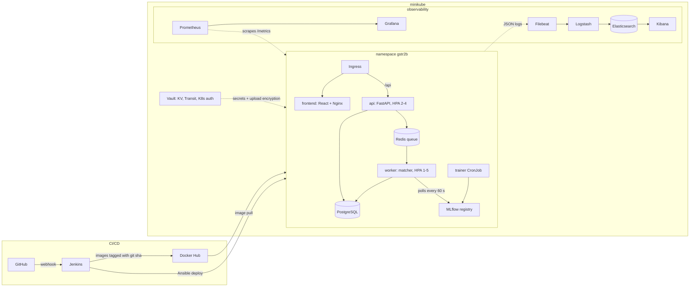

# GSTR-2B Reconciler: Final Report

| | |
|---|---|
| Course | CSE 816 Software Production Engineering, Capstone Project, 2026-27 |
| Team | Kanav Bhardwaj (Paradox-73), Bhavya Jain (Bhavzzzzzz) |
| Repository | https://github.com/Paradox-73/GSTR-2B-Reconciler |

> Draft. Sections marked TODO wait on open issues (#14 webhook, #67 Prometheus + Grafana, #26 rehearsal).

## 1. The application

Every month, an Indian business registered for GST matches its purchase register against GSTR-2B, the statement the government generates from its suppliers' filings. Input tax credit can only be claimed for invoices that appear in GSTR-2B, so every missing or mismatched invoice is money at stake. Small CA firms do this by hand in Excel, client by client.

The app takes a client's GSTR-2B JSON and purchase register (xlsx or csv), matches the invoices, puts each one in a category (matched, probable match, needs review, mismatch, missing in 2B, missing in books, ITC not available) with reason codes, and drafts a follow-up note for each supplier. Exact matching handles clean pairs. An XGBoost model scores the leftovers, which differ by typos in the invoice number, a wrong GSTIN character, rounding or a shifted date. The CA's accept and reject clicks become training labels, and a retraining job promotes a new model only if it passes a quality gate.

Real client data is confidential, so `datagen/` generates paired datasets with planted errors and known answers. A fixed-seed run is the golden set the pipeline tests against.

## 2. Architecture

| Service | Why it is separate |
|---|---|
| api | Thin and fast: auth, uploads, run status, results. Parsing runs in a child process so a large xlsx can't block health checks |
| worker | The heavy part (matching + model scoring). It is the part that needs to scale, so it has its own HPA |
| trainer | Runs on a schedule and never touches live traffic |
| frontend | Static build served by Nginx, which also proxies `/api` in the compose setup |

`api`, `worker` and `trainer` are three targets of one Dockerfile because they share all their Python code; each is still built, scanned, pushed and rolled out on its own.

## 3. Pipeline, stage by stage

A push to `main` starts the Jenkins job through the GitHub webhook ("GitHub hook trigger for GITScm polling"). The Jenkins server itself is defined in `deploy/jenkins/` (image + Configuration as Code), so one `docker compose up` gives a working Jenkins with credentials and the job already set up.

| Stage | Tool | Fails the build when |
|---|---|---|
| Lint + unit tests | ruff, pytest, Vitest | any test fails |
| Golden-set test | pytest + datagen | any category count differs from the known answer |
| Model quality gate | trainer evaluation | precision < 0.98 or recall < 0.95 on the pairs the model is responsible for |
| Build | Docker (buildx) | build error |
| Scan | Trivy | a fixable CRITICAL CVE in any image |
| Push | Docker Hub | push error |
| Deploy | Ansible `app_deploy` role | migrations Job fails or a rollout is not healthy in time |
| Smoke test | `scripts/smoke_test.py` | login, upload or a 20-invoice reconciliation fails, or its result is wrong |
| Rollback | `kubectl rollout undo` | runs only after a failed smoke test, only on deployments this build changed |

The same tests also run on every pull request in GitHub Actions, together with `kubectl kustomize`, `ansible-playbook --syntax-check` and `docker compose config` on the infra files.

**Containers and Kubernetes.** Images run as non-root. Manifests use kustomize: a base (`deploy/k8s`) and a Vault overlay (`deploy/k8s-vault`) chosen by one Ansible variable. Deployments use rolling updates with `maxUnavailable: 0`, readiness probes and a `preStop` sleep. PostgreSQL and Redis are StatefulSets. Migrations run as a Job before each API rollout.

**Configuration as code.** `deploy/ansible/site.yml` sets up a fresh Ubuntu machine with the roles `common`, `docker`, `k8s_cluster` (minikube, kubectl, helm), `vault`, `elk` and `app_deploy`. Jenkins only runs `deploy.yml` (the `app_deploy` role) on each commit. Every role is idempotent: a second run reports `changed=0`.

## 4. Monitoring and observability

**Logs (ELK).** Every service writes one JSON object per line with `service`, `event`, `request_id` and `run_id`. Filebeat ships container logs to Logstash, which parses the JSON into `app.*` fields, then Elasticsearch and Kibana. Four dashboards (operations, reconciliation, model, pipeline) are generated by `deploy/elk/build_dashboards.py` and imported by the `elk` role. Filtering `app.run_id:<id>` in Kibana shows every line of one reconciliation across the api and worker pods. Logs carry IDs and counts only, never invoice amounts or supplier names.

**Metrics (Prometheus + Grafana).** TODO after #66/#67: request rate, error rate and p95 latency per route from the api; runs per minute and run duration from the workers; per-pod CPU and memory from the kubelet's cAdvisor endpoint; worker replica count during the load test.

## 5. Cutting-edge extensions

**MLOps: gated retraining with model hot-swap.** MLflow stores each model version with its metrics, training-data hash and git sha. The trainer CronJob retrains from the CA's review decisions plus synthetic pairs, and the `production` alias moves only if the candidate passes the gate on the golden set and a held-out slice of real labels, and its F1 is not lower than the current model's. Workers poll the registry every 60 seconds and swap the model in memory, so a promotion needs no pod restart. Every run records the model version it used. The gate earned its place: on the harder generated data, model v1 scored precision 0.81 and was blocked; v2 passed.

**DevSecOps: Vault and image scanning.** Pods get the database password, JWT key and API token from Vault's KV engine through the Vault Agent Injector, authenticating with Vault's Kubernetes auth method (one policy per service). Uploaded files are encrypted with Vault's Transit engine before they reach disk: files on the volume start with `vault:v1:`, and the key never leaves Vault. If Vault is down, uploads fail with 503 instead of falling back to plaintext. Trivy scans every image on every build; on its first real run it blocked three fixable CRITICAL CVEs (brotli, openssl) in the frontend base image, fixed by upgrading Alpine packages. TODO #68: CycloneDX SBOM per image, archived with each build. TODO #19: Jenkins reads the Docker Hub token from Vault.

## 6. Results

Measured on minikube (4 CPU, 6 GB) on a Windows laptop with Docker Desktop.

| Check | Result |
|---|---|
| Full pipeline, push to smoke test | all stages green in ~13 min (first build, cold caches) |
| Smoke test with a broken password | smoke fails with 401, api/worker/frontend rolled back automatically |
| Zero-downtime rollout | k6, 3 min steady traffic with `rollout restart` of api + frontend in the middle: 0 failed of 7,203 requests, p95 19 ms |
| HPA under load | k6 spike: workers 1 -> 3 -> 4 -> 5 in ~4.5 min; 287 runs of 2,000 invoices, 0 failed, p95 run time 15 s |
| Reconciliation time | 2,000 invoices: under 30 s target, p95 15 s under load |
| Memory | node at ~4.8 GiB of 6 with app + ELK + Vault |

## 7. Challenges

| Problem | Cause | Fix |
|---|---|---|
| A rollout under load still failed 18 of ~1,900 UI requests | Pods stopped before the ingress removed them from its endpoints | `preStop` sleep and 2 frontend replicas: 0 of 4,131 |
| Workers deadlocked on the first job | rq's default worker forks per job after XGBoost and the model-polling thread had started | rq `SimpleWorker`, no fork |
| HPA held the workers at 5 replicas while idle | Each liveness probe started Python and imported rq, ~100m CPU per pod | Probes check the age of a heartbeat file the worker writes |
| One supplier with 2,000 unmatched invoices took 134 s | Candidate generation paired every leftover with every other (4 million pairs) | Window by date and amount, cap at 25 candidates: 50,000 pairs, 4.7 s |
| Fresh cluster: migrations Job failed | The ConfigMap was applied after the migrations Job that needs it; hidden on the test cluster because the ConfigMap already existed | ConfigMap and Redis go out with PostgreSQL in the first step |
| Dev-mode Vault forgets everything on restart | Dev mode keeps data in memory | The `vault` role re-creates engines, policies and secrets on every run |
| A large xlsx upload stalled health checks | pandas parsing holds Python's GIL | Parsing in a separate process with size and row limits |

## 8. Running it

Minimum: 4 CPU cores and 8 GB RAM for Docker (minikube gets 6 GB). ELK is the largest part; it can be applied only for the logging part of the demo. Steps are in `docs/demo.md`; the Jenkins setup is in `deploy/jenkins/README.md`.

## 9. Contributions

TODO: fill in from the git history at submission time, and sign the separate contribution statement.

| Member | Code | DevOps |
|---|---|---|
| Kanav Bhardwaj | datagen, matcher, model, trainer, api, frontend | CI on pull requests, first drafts of Jenkinsfile, K8s manifests, Ansible roles, Vault and ELK; k3s test runs |
| Bhavya Jain | TODO #66 metrics | minikube bring-up and fixes, Docker Hub, Jenkins on the real cluster, ELK and Vault in-cluster, load tests, TODO #67 #68 |
